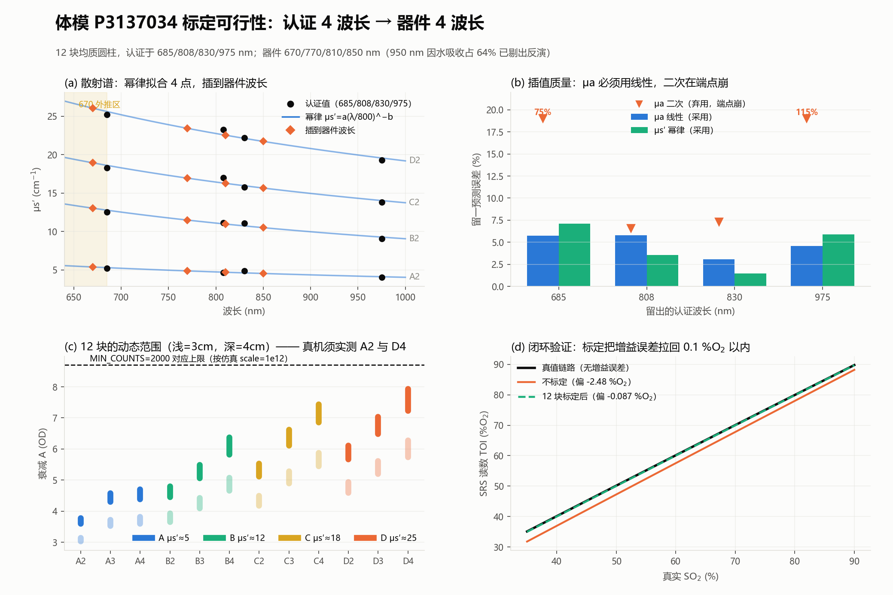

# SRS 体模标定 —— 新硬件 + 体模组 P3137034

独立验证环境，代码在 [`software/srs_cal/`](../software/srs_cal/)。**不改动现役 MBLL 产品线的任何代码。**



---

## 0. 结论

**可以标定。** 闭环验证：注入已知增益误差 −2.48 %O₂，12 块标定后残 **−0.087 %O₂**。
误差地板由体模认证不确定度决定，认证不确定度 2% 时为 **0.21 %O₂**。

自检 **17/17 通过**：

```bash
cd software && python -m srs_cal.selftest
```

| 限制 | 状态 |
|---|---|
| 均匀半无限假设 | 本包不验证分层几何 |
| 绝对准确度 | 仍需人体受控降氧标定定 k、b |
| 体模折射率 | 厂家答复 1.42，已采用；敏感度实测很低（±0.24 %O₂），非风险项 |
| 真机动态范围 | 未实测，见 §4 |

---

## 1. 硬件与体模

| | 内容 |
|---|---|
| 光源 | 1 个，五波长 670 / 770 / 810 / 850 / 950 nm |
| 探测器 | 2 个长距 @ **3.0 / 4.0 cm**（无短距，SSR 不适用） |
| 进反演的波长 | **670 / 770 / 810 / 850**（950 剔出，见 §2） |
| 体模 | MH Limited P3137034，12 块均质圆柱 Φ10.0 × 5.0 cm |
| 体模认证 | **685 / 808 / 830 / 975 nm**，多距离 + 时域法，Operator CL，2026-09-22 |

体模网格是 **4 档散射 × 3 档吸收**（注意 [SRS路线.md](SRS路线.md) §4.3 假设的是 3×4）：

| | μa≈0.05 | μa≈0.085 | μa≈0.125 |
|---|---|---|---|
| **A** μs′≈5 | A2 | A3 | A4 |
| **B** μs′≈12 | B2 | B3 | B4 |
| **C** μs′≈18 | C2 | C3 | C4 |
| **D** μs′≈25 | D2 | D3 | D4 |

---

## 2. 为什么剔除 950 nm

**依据是在体实测，不是文献估算。**

取 10 名成人前额的时域 DOS 实测 μa(λ)（Zenodo [10.5281/zenodo.15828014](https://doi.org/10.5281/zenodo.15828014)，CC-BY 4.0），用本器件的四个反演波长拟纯 HbO/HbR 模型 —— 与 `mua_to_toi()` 实际做的事完全一致 —— 再看各波长残差：

| λ(nm) | 残差 =（实测 − 纯血红蛋白预测）/ 实测 |
|---|---|
| 670 | −0.1% ± 0.4% |
| 770 | +0.3% ± 1.3% |
| 810 | −0.5% ± 0.7% |
| 850 | +0.2% ± 0.5% |
| **950** | **+40.0% ± 2.5%** ← 带外 |

**四个在用波长上纯血红蛋白模型几乎完美**（|残差| 最大 0.5%），而 950 nm 有 **40% 的吸收不是血红蛋白**（水 + 脂质）。

直接后果 —— 同一批人、同一张消光表：

| 配置 | SO₂ |
|---|---|
| 四波长 670/770/810/850 | 77.6 ± 3.6 % |
| 五波长（加 950） | 87.2 ± 3.1 % |

**加入 950 使 SO₂ 偏高 +9.6 %O₂。**

[`srs.py`](../software/fnirs_pipeline/srs.py) 的 `compute_toi()` 文档串记录了同一机理：「水与脂质吸收未建模…970nm 处水峰使 μa 从 0.157 升到 0.377」。

⚠️ **锚点波长的选取会改变结论**：若改用 660~750 nm 做锚点，该段被 HbR 主导、条件数差，外推到 770~850 会给出 −18~−30% 的假残差。必须用与实际反演一致的波长组 —— 这是 [`validate_950.py`](../software/srs_cal/validate_950.py) 的全部要害。

⚠️ 体模是干材料、不含水，**950 nm 在体模上照常可测**，采集时一并存档备查。问题只在组织侧。

```bash
cd software && python -m srs_cal.validate_950      # 从原始数据集复现上表
```

---

## 3. 插值方法

器件波长与认证波长不重合，必须插值。670 是**外推**（低于 685 共 15 nm），其余三路为内插。

| 量 | 模型 | 参数数 |
|---|---|---|
| μs′(λ) | 幂律 `a·(λ/800)^(−b)`（Mie） | 2 |
| μa(λ) | **一次**多项式 | 2 |

### μa 绝对不能用二次

留一交叉验证（12 块中位）：

| 留出波长 | **一次（采用）** | 二次（弃用） | 认证不确定度 |
|---|---|---|---|
| 685 | **5.76%** | 74.77% | 1.69% |
| 808 | **5.80%** | 6.58% | 1.93% |
| 830 | **3.07%** | 7.29% | 1.93% |
| 975 | **4.56%** | 115.45% | 2.23% |

本体模 μa 谱很平（全谱变化仅约 10%），认证不确定度已有 1.7~2.2%。4 个点拟 3 个参数就是在拟噪声，**二次在两个端点直接崩** —— 而 670 恰恰要外推到 685 以下。

μs′ 幂律留一误差：内点 1.47~3.57%，端点 5.89~7.08%。

---

## 4. ⚠️ 必须先实测的两件事

### 动态范围

12 块在 3.0/4.0 cm 下的衰减跨度很大：

| | A(4cm) |
|---|---|
| A2（最亮） | 3.60 OD |
| D4（最暗） | 7.94 OD |

**最暗比最亮低 2.17 万倍。** 必须实测确认：A2 不饱和，且 D4 的最远端计数高于 `MIN_COUNTS=2000`。

退路：组织 μs′ 在 8~12，**B/C 两行（11~19）正好括住**。动态范围不够时优先保 B/C，退化成 2×3=6 块，G 的 σ 按 √(12/6)=1.41 倍劣化。

另：[`config.py`](../software/config.py) 记着长距通道目前**对空气都饱和**，这一项得先解决。

### 体模尺寸

Φ10 cm 对 ρ=4 cm 偏小，光子分布横向展宽接近边界，半无限假设可能不成立。建议用 [SRS路线.md](SRS路线.md) §4.4 的方法核算边界修正。**这一条尚未做。**

---

## 4b. 折射率：已确认，且不是风险项

datasheet 正文未给，**厂家 2026-10 答复 n = 1.42**，已采用。

量化之后它的影响很小 —— n 在 1.40~1.62 之间变化（跨度 0.22，远超任何合理不确定度）：

| 体模真实 n | 假设 1.54 时的 TOI 偏差 |
|---|---|
| 1.40 | −0.241 %O₂ |
| 1.50 | −0.075 |
| 1.62 | +0.163 |

**比光谱插值误差还小。** 原因：n 经外推边界 z_b 进入，而在 ρ=3~4 cm 处边界项只是小修正，且两个探测器看到的几乎相同，**在斜率里大部分抵消**。

**块间一致性不用担心**：散射档位靠散射体浓度拉开，体积分数仅 7.4e−5（A 行）~3.7e−4（D 行）。即使散射体 n=2.7，A→D 的有效折射率差也只有 **3.4e−4**，对 TOI 的影响 +0.0008 %O₂。12 块可视为同一折射率。

> 注：1.42 明显低于环氧树脂（~1.54），本体模基体大概率不是环氧。

**真正还该问厂家的是另外三条**（[SRS路线.md](SRS路线.md) §4.5 的「待追问」）：μa/μs′ 的不确定度是否 GUM 溯源、块内均一性指标、**温度系数（%/°C）**。这三条比折射率值钱 —— 护理说明只写了「远离热源」，没给数。

---

## 5. 标定流程

### 5.1 采集

```bash
cd software
python -m srs_cal.acquire              # 连真机
python -m srs_cal.acquire --simulate   # 无硬件排练（用正演模型造数据）
```

界面:串口设置 → 实时 ADC(5 波长 × 2 距离)→ **12 个体模按钮 + 1 个暗电平按钮** → 保存 xlsx 到 `srs_cal/`。

- 点某块的按钮,连收 N 帧(默认 200,约 20 个扫描周期),对每个「波长 × 距离」组合算均值/标准差/帧数
- **同一块可以反复采**,每次是一个 take。这是评估**重贴合变异**的唯一途径 —— 这一项在实际中往往比块间差异更大,而体模块的 holdout 完全测不到它
- 状态栏实时显示帧率、丢弃字节、校验错。**这两个计数不为零就停下来查线,不要带病采数**
- 950 nm 照常采集并存档,标定时自动跳过

xlsx 三个表:**明细**(每 take 每组合一行)、**汇总**(列名与下一步直接对接,多 take 取均值并给出重贴合离散)、**元信息**(协议、折射率、波长、数据来源)。

### 5.2 标定

```bash
cd software
python -m srs_cal.run_calibration --xlsx srs_cal/标定采集_YYYYMMDD_HHMMSS.xlsx \
    --baseline 基线.csv --out G.npy
```

(也支持手工录入:`--emit-template 实测.csv` 生成模板,再 `--csv 实测.csv`)

### 5.3 串口协议

由实机日志逐帧反推,7 帧全部对上**含校验**:

| 偏移 | 长度 | 含义 |
|---|---|---|
| 0 | 2 | 帧头 `55 AA` |
| 2 | 1 | 包长 `0x1A` = 26 |
| 3 | 1 | 帧标识 `0x02` = 数据帧 |
| 4 | 1 | 波长码 `01`~`05` → 670/770/810/850/950 nm |
| 5 | 1 | 距离码 `01`=3 cm,`02`=4 cm |
| 6 | 4 | ADC,**大端 uint32** |
| 10 | 1 | 通道号,当前样机固定 `01` |
| 11 | 14 | 保留,实测全 0 |
| 25 | 1 | 校验 = `sum(bytes[2:25]) & 0xFF` |

校验起点是**第 2 字节**(不含帧头)—— 这一条是反推的:含帧头求和会恒差 `0x55+0xAA=0xFF`,7 帧表现一致。

一个完整扫描周期 = 5 波长 × 2 距离 = 10 帧。

产出的 `G(λ)` 这样用：

```python
from srs_cal import hardware as hw
from fnirs_pipeline.srs import compute_toi
import numpy as np

geom = hw.geometry(gain_correction=np.load("G.npy"))   # 后续 k、b 由降氧标定补
result = compute_toi(intensities, geom)                 # intensities: (4, 2)
```

---

## 6. 验收判据

### 12 块全部用于拟合，**不分标定集/验证集**

每波长只有 1 个待定参数、12 个观测，过拟合不是风险。而切分有确定代价：9 块拟合的 σ 恒为 12 块的 **√(12/9)=1.14 倍**（三个噪声水平下实测一致）。且设定错误时 9 块反而更差（1% 串扰下偏差 1.385 vs 1.302 %O₂）—— 花精度换零信息。

### 判据一：块间 G 离散

对每块单独反推 G，看 12 个结果的标准差。不花数据，且比留一交叉验证更灵敏：

| 近→远串扰 | 块间离散 | 倍数 | 3× 判据 |
|---|---|---|---|
| 0%（基线） | 0.00330 | 1.0× | — |
| 0.1% | 0.00628 | 1.9× | 漏掉 |
| 0.5% | 0.02585 | **7.8×** | 抓住 |
| 1.0% | 0.04822 | **14.6×** | 抓住 |

0.1% 低于判据灵敏度，但其 TOI 影响本身也 <0.05 %O₂。

**基线必须实测**：同一台确认良好的系统重复标定 ≥5 轮取中位。未给基线时程序显式标出「本次结果不可直接放行」，不会默认通过。

### 判据二：G 对 μa / μs′ 的趋势

离散小**不等于**没问题。G 随块的光学参数系统漂移，说明 G-as-常数 这个模型形式错了，外推到组织会有系统偏差 —— 离散检验抓不到。

**阈值必须做 Bonferroni 修正。** 每次标定跑 4 波长 × 2 = 8 次检验，裸用 t=2.228 时实测族系误报率 **29.8%**（400 次干净闭环）：

| 阈值 | 至少报一次假警 | 单项误报率 |
|---|---|---|
| 2.228 | 29.8% | 4.62% |
| 3.169 | 8.5% | 1.16% |
| **3.448（采用）** | **~5%** | ~0.7% |
| 4.000 | 1.2% | 0.16% |

取 α=0.05/8 → t(df=10)=**3.448**，实测族系误报率 3.3%。

---

## 7. 文件

| 文件 | 内容 |
|---|---|
| [`srs_cal/hardware.py`](../software/srs_cal/hardware.py) | 波长、几何、折射率；**不 import config** |
| [`srs_cal/phantom.py`](../software/srs_cal/phantom.py) | P3137034 认证数据原文 + 光谱插值 + 留一验证 |
| [`srs_cal/forward.py`](../software/srs_cal/forward.py) | Farrell-Patterson 正演（自检第 1 项与 `tools/srs_reference.py` 逐点比对） |
| [`srs_cal/calibrate.py`](../software/srs_cal/calibrate.py) | G(λ) 拟合 + 两项验收判据 |
| [`srs_cal/protocol.py`](../software/srs_cal/protocol.py) | 串口帧解析与流式拆包 |
| [`srs_cal/acquire.py`](../software/srs_cal/acquire.py) | **采集软件**（12 块按钮 + 暗电平，存 xlsx） |
| [`srs_cal/run_calibration.py`](../software/srs_cal/run_calibration.py) | 吃 xlsx / CSV 的命令行入口 |
| [`srs_cal/validate_950.py`](../software/srs_cal/validate_950.py) | 用在体数据复核 950 nm 的取舍 |
| [`srs_cal/selftest.py`](../software/srs_cal/selftest.py) | 8 组 17 项自检，无需硬件 |
| [`srs_cal/figures.py`](../software/srs_cal/figures.py) | 本文的图 |

**算法本体复用** [`fnirs_pipeline/srs.py`](../software/fnirs_pipeline/srs.py) —— 该模块只 import `.mbll_core`，几何与标定常数全部经 `SrsGeometry` 传参，不读 `config`。所以这里跑的就是产品代码，不是副本。其自身验证见 [`tools/srs_verify_chain.py`](../software/tools/srs_verify_chain.py)（15/15）。

---

## 8. 数字来源

- §2 水吸收：Hale & Querry *Appl Opt* 12(3):555 (1973) / Segelstein (1981) 纯水谱；血红蛋白消光用项目的 `wray` 表
- §1、§3 体模参数：MH Limited datasheet，Trace Code P3137034，2026-09-22，**原文誊录未加工**
- §2 在体残差与 SO₂ 对比：`srs_cal.validate_950`，10 人前额 TD-DOS 实测
- §3 留一误差、§4 动态范围、§4b 折射率敏感度、§6 全部判据数字：`srs_cal.selftest` 实测，可复现
- §5.3 协议：由实机串口日志逐帧反推，7 帧全部对上（含校验）
- §6 的 1.14×、串扰偏差：12 块 vs 9 块对照仿真，各 200~400 次重复

⚠️ **共同适用边界**：均匀半无限介质 + Farrell-Patterson 稳态扩散解。真实头部为分层结构，本文全部结论在分层几何下**未经验证**。TOI 反映「脑 + 头皮混合」组织的血氧。**未经临床验证，不可用于诊断。**

---

## 附：现场速查表（预期相对读数）

以 **A2 的 810 nm @ 3 cm = 1.000** 为基准。与 LED 功率、积分时间无关，同一探测器内的增益也约掉 —— 所以现场测完 A2 就能预判其余每一块该读多少，**偏离一个数量级就是采歪了**（贴合不良 / 拿错块 / 饱和）。

### 3 cm

| 块 | 670 | 770 | 810 | 850 | 950 | I(3)/I(4) @810 |
|---|---|---|---|---|---|---|
| A2 | 0.780 | 0.938 | **1.000** | 1.062 | 1.214 | 4.0× |
| A3 | 0.199 | 0.265 | 0.293 | 0.322 | 0.399 | 6.3× |
| A4 | 0.164 | 0.228 | 0.257 | 0.287 | 0.368 | 6.7× |
| B2 | 0.119 | 0.174 | 0.199 | 0.225 | 0.299 | 6.5× |
| B3 | 0.038 | 0.059 | 0.070 | 0.081 | 0.114 | 9.7× |
| B4 | 0.0086 | 0.0152 | 0.0186 | 0.0226 | 0.0353 | 15.8× |
| C2 | 0.032 | 0.050 | 0.058 | 0.067 | 0.094 | 9.3× |
| C3 | 0.0052 | 0.0088 | 0.0106 | 0.0127 | 0.0191 | 17.6× |
| C4 | 0.0013 | 0.0024 | 0.0030 | 0.0036 | 0.0057 | 27.7× |
| D2 | 0.0114 | 0.0182 | 0.0214 | 0.0251 | 0.0358 | 12.3× |
| D3 | 0.0024 | 0.0043 | 0.0052 | 0.0063 | 0.0098 | 20.9× |
| D4 | 0.0005 | 0.0011 | 0.0014 | 0.0018 | 0.0032 | 33.6× |

### 4 cm（同一基准）

| 块 | 670 | 770 | 810 | 850 | 950 |
|---|---|---|---|---|---|
| A2 | 0.1770 | 0.2271 | 0.2480 | 0.2694 | 0.3244 |
| A3 | 0.0278 | 0.0406 | 0.0464 | 0.0527 | 0.0701 |
| A4 | 0.0208 | 0.0326 | 0.0382 | 0.0444 | 0.0625 |
| B2 | 0.0157 | 0.0256 | 0.0304 | 0.0358 | 0.0516 |
| B3 | 0.0032 | 0.0058 | 0.0072 | 0.0088 | 0.0138 |
| B4 | 0.00042 | 0.00090 | 0.00118 | 0.00153 | 0.00275 |
| C2 | 0.0029 | 0.0051 | 0.0062 | 0.0075 | 0.0116 |
| C3 | 0.00023 | 0.00047 | 0.00060 | 0.00076 | 0.00131 |
| C4 | 0.00004 | 0.00008 | 0.00011 | 0.00014 | 0.00025 |
| D2 | 0.00077 | 0.00141 | 0.00175 | 0.00214 | 0.00340 |
| D3 | 0.00009 | 0.00019 | 0.00025 | 0.00032 | 0.00057 |
| D4 | 0.00001 | 0.00003 | 0.00004 | 0.00006 | 0.00012 |

### ⚠️ 动态范围判据

最亮 **A2 @ 950 nm / 3 cm** 到最暗 **D4 @ 670 nm / 4 cm**，跨度 **1.07e5 倍 = 5.0 个数量级**。

单一增益档下，设 A2@950/3cm 实测为 `V`，则任意一格的预期读数 = `V × (表中值 / 1.214)`。低于 `MIN_COUNTS = 2000` 的格子不可用。

**若 ADC 为 24 位（满量程 ~1.67e7）、把 A2 顶到 1.5e7**：预期 C4 / D3 / D4 落到 2000 以下，C3 临界。**也就是单档增益大概率只能拿到 9 块。**

9 块够用 —— σ 只比 12 块差 √(12/9) = 1.14 倍，而且剩下的 A/B/C2/D2 仍覆盖 μs′ 5~25。但**必须现场实测确认，不要照搬这个推断**。
