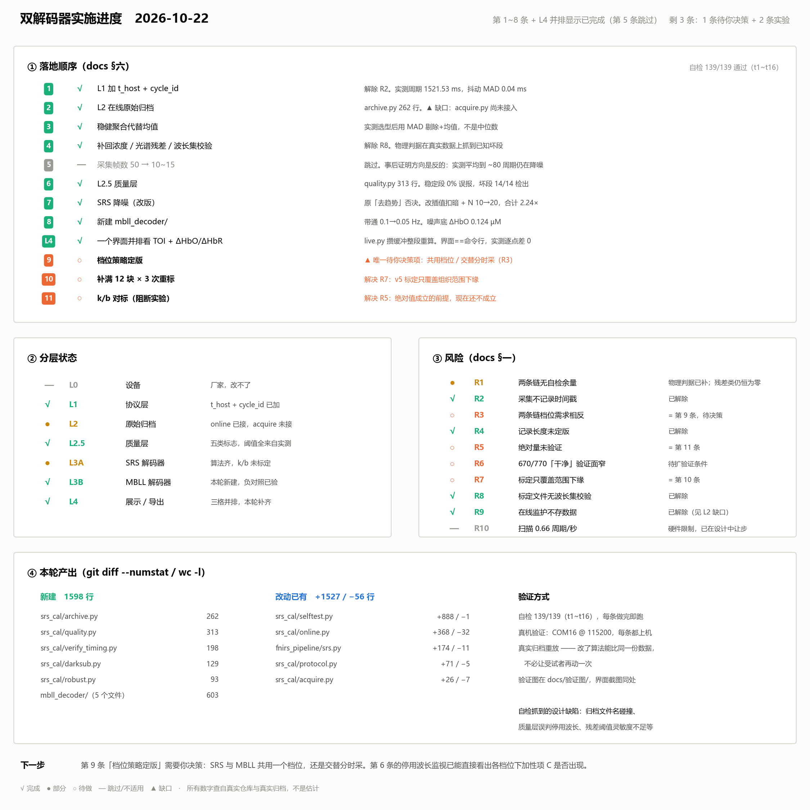
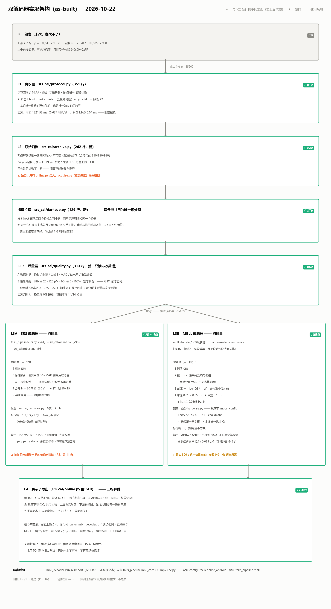
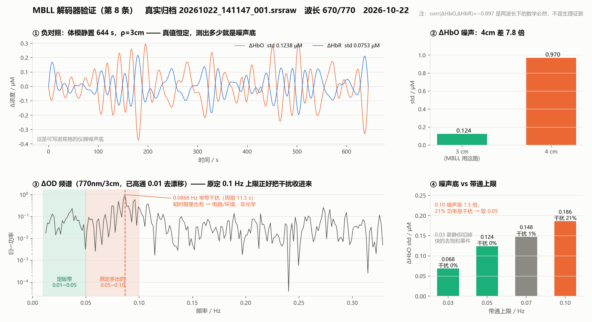
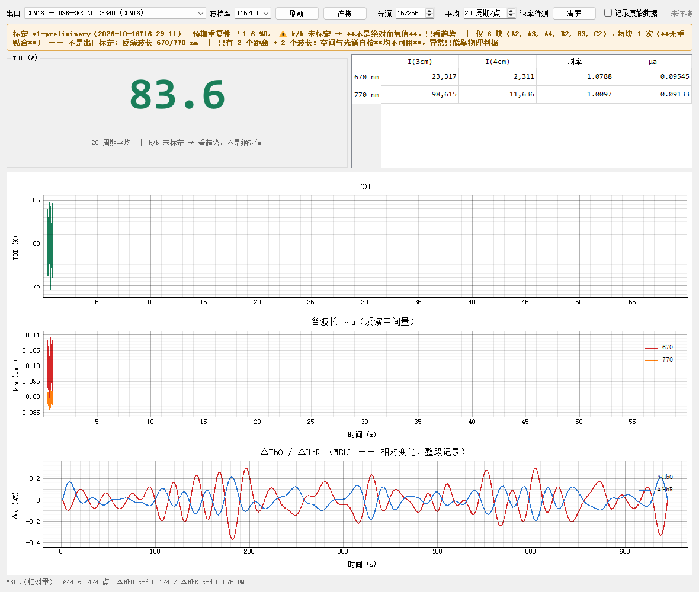

# 双解码器架构：SRS 绝对量 + MBLL 相对量

目标：同一台硬件（1 源 + 2 探，3.0/4.0 cm，五波长）上并行跑两条解码链，
**互不干扰、可分别标定、可分别调试降噪**。

> **2026-10-22 定版决策**：MBLL **不再输出 rSO2**，血氧绝对值一律由 SRS 给出。
> 本文按该决策重写。改动见 §七。

本文结论全部基于 2026-10-12 ~ 10-22 的实测，关键数字标了出处。

---

## 图

| 图 | 内容 | 生成脚本 |
|---|---|---|
|  | 落地顺序 11 条 / 分层状态 / 风险 R1~R10 / 本轮产出 | `docs/fig_prog.py` |
|  | as-built 架构（与下面 §二 的设计稿差异用 ★ 标出） | `docs/fig_arch.py` |

> §二 的 ASCII 图是**设计稿**，上面的 PNG 是**实况**。两者不一致处以实况为准，
> 差异原因都写在 ★ 后面 —— 都是实测后改的，不是漏实现。

---

## 一、风险点（这些决定架构长什么样）

### R1 ⚠️ 两条链现在都没有任何自检余量

| 自检手段 | 需要 | 现状 | 结果 |
|---|---|---|---|
| 空间残差 | ≥3 个距离 | 2 个（3/4cm） | 残差**恒等于 0** |
| 光谱残差 | ≥3 个波长 | 2 个（670/770） | 残差**恒等于 0** |

`srs.py:fit_slopes` 注释已写明「2 个探测器时残差恒为零，这正是必须 ≥3 点的原因」。
MBLL 侧同理：670/770 解 HbO/HbR 两个未知数，矩阵是 2×2 可逆方阵（cond = 7.80），
**任何输入（包括纯噪声）都会被映射成一对浓度，残差为零**。

→ 架构必须从别处拿质量信号。见 L2.5 —— **物理判据 + 停用波长监视**。

### R2 ⚠️ 采集不记录时间戳 —— 卡死 MBLL

`逐帧` 表只有 `seq`。用 take 时间戳倒推采样率，6 组在体给出
0.67 / 1.02 / 12.50 / 25.00 周期每秒，**跨度 37 倍**，不可用。

`mbll.py:159` 硬性要求 `Time (s)` 列，缺列直接拒收；`_estimate_fs` 也靠它。
采样率错了，按 Hz 指定的带通就滤在错误频段 —— **比不滤更危险**。

→ **MBLL 的唯一硬阻塞。只能在 L1 解决**：帧一旦进上层，时间永久丢失。

### R3 ⚠️ 两条链对档位需求相反

- SRS：4cm 信号不足，实测需 ×8 通量才到 ±1 %O₂，倾向高档位
- 加性伪信号 C 有**电流阈值**：档位 90 时 810@4cm ≈ 300，档位 130 时 69,885

→ 共用采集就得共用档位。**需决策：共用档位，还是交替分时采。**

### ~~R4 记录长度未定版~~ —— 已解除（2026-10-22）

**本项目是脑血氧连续监护，不做任务激活。** 两点澄清：

1. **临床用例是连续流，不是定长 take。** `online.py` 是滑动窗
   （`online.py:600` 「每收齐一个新扫描周期出一个点」），`MAXPTS = 20000`
   即 20000 个扫描周期，按实测 **0.657 周期/秒**约 **8.5 小时**历史。
   > ⚠️ 上一版这里写「按 12.5 周期/秒约 27 分钟」—— **12.5 是实测前的猜测值**，
   > R10 的实测是 0.657。结论方向不变（远超带通所需），但数字错了，故更正。
2. 此前「记录只有 8~327 秒」的分析，比的是 **`acquire.py` 的标定采集**
   （手持探头压体模，本就短）—— **对象搞错了**，与临床流无关。

→ **带通的最短记录约束不卡临床用例**（连续监护的时长远超所需）。
但解码器**仍硬性要求 ≥300 s**（`decoder.py` 的 `min_record_s`）——
短记录（标定 take、调试片段）必须被拒，否则滤出来的是滤波器瞬态。
实测：99 s 的手臂归档被正确拒绝。频带按脑血氧的生理时间尺度定：

| 成分 | 频率 | 奈奎斯特 0.33 Hz 下 | L3B 保留 |
|---|---|---|---|
| 仪器漂移 | < 0.01 Hz | — | ✗ 高通滤除 |
| 去饱和事件 | 0.01 ~ 0.05 Hz | ✓ 可测 | ✓ |
| ~~Mayer 波~~ | ~~~0.1 Hz~~ | 落在 0.0868 Hz 干扰上 | ✗ 一并滤除 |
| 呼吸 | 0.2 ~ 0.3 Hz | **✗ 混叠** | ✗ |
| 心搏 | 0.8 ~ 2 Hz | **✗ 混叠** | ✗ |

**定版：L3B 带通 0.01 ~ 0.05 Hz。**

> ⚠️ **2026-10-22 修正（一）。** 上一版定的 0.01~2 Hz **物理上不可能** ——
> 真机实测扫描速率 **0.66 周期/秒**（见 R10），奈奎斯特仅 **0.33 Hz**，
> 2 Hz 超出 6 倍。呼吸与心搏在当前硬件上**完全测不到**。
>
> ⚠️ **2026-10-22 修正（二）。** 随后改定的 0.01~**0.1** Hz 也不可用 ——
> §二·十 查出噪声主成分是 **0.0868 Hz 的窄带干扰**，正落在该带内。
> 实测 0.10 上限时 ΔHbO 噪声底比 0.05 上限**高 1.50 倍**，且输出功率的
> **21%** 落在干扰带内。改为上限 **0.05 Hz**（干扰占比 0.00%）。
> 代价是 Mayer 波一并滤掉，但它本就被该干扰污染。见 §二·十二。

### R10 ⚠️ 扫描速率仅 0.66 周期/秒 —— 奈奎斯特 0.33 Hz（2026-10-22 真机实测）

`verify_timing` 连真机测得（COM16 @ 115200，三次独立采集一致）：

| 量 | 实测 |
|---|---|
| 扫描速率 | **0.66 周期/秒**（8 帧/秒） |
| 周期间隔 | **1521.53 ms**，MAD **0.04 ms（0.003%）** |
| 离群间隔 | 1 / 46 |
| 丢弃字节 / 校验错 / 短周期 | 0 / 0 / 0（552 帧） |
| 波特率占用 | **2%** |

**设备时基极稳**（MAD 0.003%），链路完全干净 —— 这两项是好消息。
问题在速率本身：

- **奈奎斯特 = 0.33 Hz。** 呼吸（0.2~0.3 Hz）贴边，心搏（0.8~2 Hz）**完全混叠**。
- 由此**作废**两件事：
  1. L3B 原定的 0.01~2 Hz 带通（已改，见 R4）
  2. 「用心搏谱峰当贴合质量判据」这条路 —— 它是此前唯一找到的
     「区分手臂与桌面」的候选判据
- `acquire.py:231` 的 `pulsatility()` 守卫要求 ≥6 周期/秒，
  **故该功能在真机上从未产出过结果**，只在模拟器里跑过。守卫做对了事。

### 给厂家的问题（优先级高）

每帧耗时 1521.53 / 12 = **126.8 ms**，而 26 字节在 115200 下只需 2.3 ms ——
**设备 98% 的时间不在传输**，应是 LED 建立 + ADC 积分占用。

要让心搏可测需 **≥5 周期/秒**（2 Hz × 2 × 1.25 余量），即周期缩到 **200 ms**。
届时波特率占用 13.5%，**仍有充足余量**。

→ 问：扫描周期能否缩短？代价是什么（单帧积分时间变短 → 信噪比下降）？
   这是一个**可量化的权衡**，不是能不能的问题。

### R5 ⚠️ SRS 的绝对量尚未验证 —— 新增定量证据

`k=1.0, b=0.0`，从未对标人体或血液体模。把被丢弃的绝对浓度解出来看：

| 在体采集 | TOI% | [HbO] µM | [HbR] µM | tHb µM |
|---|---|---|---|---|
| 113257 | **106.82** | 2.84 | **−0.18** | 2.66 |
| 160615 | 62.38 | 11.18 | 6.74 | **17.92** |
| 163458 | 91.39 | 34.90 | 3.29 | 38.19 |
| 102409 ※贴桌面 | 87.61 | 87.21 | 12.34 | 99.55 |

组织 tHb 应在 **40~80 µM**。实测跨 2.66 ~ 99.55，且出现 TOI > 100%、[HbR] < 0。

→ **绝对浓度与 TOI 目前都不能当测量值对外显示**，必须带「未标定」标志。
→ 但这两项越界本身是**免费的质检**，见 L2.5。

### R6 ⚠️ 670/770「干净」只在特定条件下验过

结论来自：优化探头 + 档位 255 + 6 块 × 1 次（dof=5）。
810/850/950 的加性项在换探头/换档位后**出现过从无到有的变化**
（旧探头 gear150 时 850 的 R²≈0，新探头 gear255 时 0.91~0.94）。

→ **换探头或换档位后必须重跑加性项回归检查。**

### R7 ⚠️ v5 标定只覆盖组织范围的下缘

| | μeff 范围 |
|---|---|
| v5 用的 6 块 | 0.913 ~ 1.862 cm⁻¹ |
| 组织（tHb 30~80µM，SO₂ 50~70%） | 1.80 ~ 3.54 cm⁻¹ |

**6 块里只有 B3(1.862)、C2(1.805) 落在组织带内，且都在最低端。**
补满 12 块 × 3 次之前，绝对值基本是外推。

---

## 二、架构图

```
┌─ L0 设备 ────────────────────────────────────────────────────────────┐
│  1 源 + 2 探（3.0 / 4.0 cm） × 5 波长（670/770/810/850/950）          │
│  上电自发数据，不响应启停，只接受档位指令（0x00~0xFF）                │
└───────────────────────────────┬──────────────────────────────────────┘
                                │ 串口字节流
                                ▼
┌─ L1 协议层   srs_cal/protocol.py（已有，需小改）─────────────────────┐
│  字节流同步（找 55AA / 容忍粘包半包） · 校验 · 字段解码 · 假帧防护     │
│  计数器：n_frames / n_dropped / n_bad_checksum ← 现成的链路质量指标    │
│  ★ 新增：t_host（perf_counter）、cycle_id                             │
│     —— 解决 R2。**唯一需要改动的已有代码**；也是唯一知道时间的层      │
└───────────────────────────────┬──────────────────────────────────────┘
                                ▼
┌─ L2 原始记录 RawRecord（新）─────────────────────────────────────────┐
│  **不可变。两条解码链唯一的共同数据输入。**                           │
│  列：t_host │ cycle │ λ │ ρ │ adc_raw │ gear                          │
│  ★ 五波长全存，含已停用的 810/850/950                                 │
│     理由（hardware.py）：「保留原始记录，才能在 670/770 将来            │
│     也出问题时有旁证」                                                │
└────────┬──────────────────────────────────────┬──────────────────────┘
         │                                      │
         │   ┌─ L2.5 质量层（新，只读不改数据）──────────────────────┐
         │   │  A 数据判据                                            │
         │   │    · 饱和 / 非正读数                                   │
         │   │    · 尖峰帧  |x−中位| > 5×MAD                          │
         │   │    · 暗时隙漂移率                                      │
         │   │    · 链路计数（取自 L1）                               │
         │   │  B 物理判据  ★ 新增，补 R1 的零自检                    │
         │   │    · tHb = [HbO]+[HbR] 必须 ∈ 20~120 µM               │
         │   │    · TOI 必须 ∈ 0~100 %                                │
         │   │    · [HbO]、[HbR] 不得为负                             │
         │   │      —— 不需要体模、不需要参考设备，只靠生理学         │
         │   │  C 停用波长监视  ★ 810/850/950 的新用途                │
         │   │    · 加性项 C 的回归检查（ratio vs 1/I 的直线性）      │
         │   │    · 发现：C 回来了 / 档位越界 / 探头状态变了          │
         │   └──────────────┬─────────────────────────────────────────┘
         │                  │ flags（两条链都读，都不写）
   ┌─────┴──────────────────┼──────────────────────────┐
   ▼                        ▼                          ▼
┌─ L3A  SRS 解码器 ─────────────┐   ┌─ L3B  MBLL 解码器 ───────────────┐
│ srs_decoder/                  │   │ mbll_decoder/（新建）            │
│                               │   │                                  │
│ 预处理（自己的，不共享）：     │   │ 预处理（自己的，不共享）：        │
│  1 逐周期扣暗                 │   │  1 逐周期扣暗                    │
│  2 中位数去尖峰               │   │  2 中位数去尖峰                  │
│  3 **去趋势**（减一条直线）    │   │  3 ΔOD = −log10(I / I_ref)       │
│    ✗ 禁止高通：会毁掉绝对值    │   │  4 **带通 0.01 ~ 0.05 Hz**（定版）│
│  4 合并 N 周期（N = 10~15）    │   │    高通在这里是必须的             │
│                               │   │                                  │
│ 配置（自己的）：               │   │ 配置（自己的）：                  │
│  hardware.py                  │   │  mbll_hw.py（新建）              │
│   WAVELENGTHS_ACTIVE 670/770  │   │   WL 670/770                     │
│   RHO_CM 3.0 / 4.0            │   │   ρ = 3.0（4cm 可另出一路深层）  │
│   G(λ)、k、b                  │   │   DPF(λ, age) Scholkmann         │
│                               │   │   ✗ 无短距 → 无 SSR              │
│ 标定链（自己的）：             │   │   ✗ 跳过 Cyt（表无 670，且       │
│  run_srs_v1.py → 标定_vN.json │   │      2 波长时数学不可解）        │
│                               │   │                                  │
│ 输出：                         │   │ 标定链：无（相对量不需要）        │
│  · TOI 绝对值                 │   │                                  │
│  · **[HbO] / [HbR] / tHb** ★  │   │ 输出：                            │
│    绝对浓度（现被 srs.py:331  │   │  · ΔHbO / ΔHbR 相对变化          │
│    的 `_` 丢掉，需补回）       │   │  · ✗ 不再有 rSO2                 │
│  · μa / μeff / slope          │   │  · ✗ 不再需要基线窗              │
│  · **未标定标志**（R5，       │   │                                  │
│    不可被下游丢弃）            │   │                                  │
└──────────┬────────────────────┘   └──────────┬───────────────────────┘
           │                                    │
           └────────────────┬───────────────────┘
                            ▼
      ┌─ L4 展示 / 导出层（只读两边）────────────────────────────┐
      │  绝对量（SRS）与 相对变化（MBLL） **并排**呈现            │
      │  L2.5 的质量标志统一显示；未标定标志必须可见              │
      │                                                           │
      │  ★ 硬性禁止：两条链不得共用任何预处理中间量               │
      │     （rSO2 取消后，「用 TOI 设 MBLL 基线」已**结构上      │
      │       不可能**，不再需要靠纪律保证）                      │
      └───────────────────────────────────────────────────────────┘
```

---

## 二·五、波长集可变性（R8）

当前只有 670/770 进反演。810/850/950 的加性项若在硬件层面解决，必须能**改回去**
而不触发静默错误。这一节是为此立的契约。

### R8 ⚠️ 标定文件与硬件波长集无校验 —— 可能静默算错

`online.py:Calibration.__init__` 只读 `gain_correction`，
**从不检查标定文件的 `wavelengths_nm` 与 `hw.WAVELENGTHS_ACTIVE_NM` 是否一致**。

| 情况 | 后果 |
|---|---|
| 长度不同 | numpy 广播报错 → 崩溃（至少是响的） |
| **长度相同、波长不同** | **静默算错** |

第二种不是假想：若将来 850 修好而 770 出问题，硬件变成 `[670, 850]`，
此时加载 v5 的 `[670, 770]` —— 长度都是 2，减法成功，
**但 G(770) 被套到 850 通道上**，屏幕照常出数，无任何提示。

标定参数目录现已有 4 路 / 3 路 / 2 路三种长度混放，该场景迟早撞上。

### 契约

| # | 规则 |
|---|---|
| ① | **标定加载时显式校验波长集**，与 `WAVELENGTHS_ACTIVE_NM` 不一致则拒绝加载并报明差异 |
| ② | 增益、消光、DPF 一律用 `{波长: 值}` 字典索引，**绝不用数组下标** |
| ③ | 自检随波长数**自动**启用，不靠人改代码 |
| ④ | 监视波长集 = `WAVELENGTHS_ALL − WAVELENGTHS_ACTIVE`，**自动推导** |

③ 的具体档位：

| 反演波长数 | 光谱残差 | 自解散射 | 动作 |
|---|---|---|---|
| 2 | 恒为 0（方阵） | 不可用 | **必须显式标记「无光谱自检」** |
| ≥3 | **可用** | 不可用 | 自动启用残差检查 |
| ≥4 | 可用 | 可选（`fit_scattering_and_toi`） | 自解散射成为可选项 |

④ 的好处：**850 修好进反演后，它自动从监视集合退出，无需改代码。**

### 已算出但被丢弃的量（恢复波长后即可用）

与 `[HbO]/[HbR]` 被 `srs.py:331` 的 `_` 丢掉是同一模式：

```python
# mua_to_toi 内
c, *_ = np.linalg.lstsq(E * LN10, mua, rcond=None)
#  ↑ 这个 *_ 里就有光谱残差
```

2 波长时它恒为 0；**一旦恢复到 ≥3 波长，它就是真正的光谱自检** —— 正是当前最缺的东西。

### MBLL 侧

`CYT_DIFFERENCE_EXTINCTION`（`config.py`）只有 700/730/770/810/850，**无 670**。
恢复到 ≥3 波长后 Cyt 变得可解，但 670 仍缺。

→ **`mbll_decoder/` 必须有自己的 cyt 表**，不 import `config` 的
（也符合 §三「配置不共享」）。

---

## 二·六、原始归档（R9）

### R9 ⚠️ 在线监护完全不存数据 —— 连续监护设备的硬伤

| | 现状 |
|---|---|
| `acquire.py` | 存 `逐帧` 表（xlsx），**标定场景够用** |
| `online.py` | **搜不到任何 save / export / to_csv / Workbook** —— 处理完即丢 |

后果：实时监护出了异常，**没有任何东西可供回看**。

### 为什么这条优先级不低

L2 是「两条链可单独调试」的**物理前提**。改了 SRS 的降噪想看效果，
没有归档就只能重新采 —— 但受试者动了、贴合变了，
**比的是两次不同的测量，不是两套算法。**

这不是推论：本文档全部的实测结论（漂移分解、尖峰统计、加性项 C、
斜率还原度）**都是从已存的 `逐帧` 表里挖出来的**。
若当初 `acquire.py` 没存逐帧，这些问题今天一个也发现不了。

### 现有 xlsx 装不下临床记录

帧率 = 12.5 周期/秒 × 12 帧 = **150 帧/秒**

| 时长 | 帧数 |
|---|---|
| 1 分钟 | 9,000 |
| 1 小时 | 540,000 |
| 8 小时 | 4,320,000 |

**xlsx 单表上限 1,048,576 行 → 约 117 分钟就爆。**

### 落地记录（2026-10-22 已完成）

模块 `srs_cal/archive.py`，已接入 `online.py`：

| 项 | 实现 |
|---|---|
| 默认行为 | **默认开启**，界面「记录原始数据」可关 |
| 轮转 | 每小时一个文件；**换档位也轮转**（见下） |
| 总量 | 上限 5 GB，超限删最旧；**当前正在写的文件永不删** |
| 落点 | `srs_cal/原始归档/`，可用 `--archive-dir` 改；已入 `.gitignore` |
| 失败处理 | 写盘出错只计数并在界面标红，**绝不中断测量** |

**换档位必须轮转**，因为原始帧里**不含档位**（档位只在出站的指令帧里），
事后无从还原。每个归档文件的头里因此恰好**一个**档位。

自检新增第 10 项，12 条检查；另有 GUI 集成验证与真机验证。

### 实现中自检抓到的两个缺陷

| 缺陷 | 后果 | 修法 |
|---|---|---|
| 文件名只到**秒** | 同一秒内轮转两次会**静默覆盖**前一个文件 | 冲突时追加 `_001` 序号 |
| 换档位**无条件**轮转 | `_send_brightness` 被防抖定时器重复触发，同档位也开新文件 → 文件碎片 | 仅在档位真的变化时轮转 |

### 真机验证（COM16 @ 115200）

- 292 帧 / 9.7 KB / 0 写入错误
- 重放还原全部 292 帧，`t_host` 误差 < 1 µs
- 换档位后归档轮转，两文件档位 `[None, 255]`
- **从归档独立算出扫描速率 0.653 周期/秒**，与 `verify_timing` 的 0.66 吻合

### 格式建议

| 方案 | 每帧 | 8 小时 | 取舍 |
|---|---|---|---|
| **原始字节 + 时间戳** | 34 B | 147 MB | **零解析风险**；回放时重新解析，顺带测解析器 |
| 解析后字段 | 20 B | 69 MB | 省空间，读取直接 |

**倾向第一种。** 理由：L1 的解析逻辑将来会改（加第二光源、厂家改协议）。
存解析结果会把**解析器的 bug 永久烙进归档**；存原始字节则可用新解析器重跑旧数据。

追加写（append-only），一个二进制文件 + 头部描述即可，不需要数据库。

---

## 二·七、稳健聚合选型（2026-10-22 已完成）

模块 `srs_cal/robust.py`，已接入 `acquire.py` 与 `online.py`。

### 为什么不是中位数

原计划「中位数代替均值」。用 2026-10-22 的**在体归档**（手臂，104 秒，68 周期）
实测比较五个估计量（窗口 N=10）：

| 估计量 | 高斯对照代价 | 真实噪声代价 | 尖峰窗口中位偏差 | 最坏偏差 |
|---|---|---|---|---|
| mean（原状） | 基准 | 基准 | **77.78%** | **2071%** |
| median | +18.1% | −4.1% | 1.79% | 33.8% |
| trim10 | +2.4% | −3.4% | 1.30% | **1208%** |
| trim20 | +5.9% | −6.1% | 1.17% | 23.4% |
| **mad_mean** | +5.6% | **+0.4%** | **0.00%** | **9.1%** |

测法自验：纯高斯下 median/mean = 1.181，理论 1.253（N=10 时略低，合理）。

trim10 最坏到 1208%，因为**一个窗口里有两个尖峰**时，两端各砍一个还剩一个。
**mad_mean 两项都最好**，故采用，判据 5×MAD（≈3.37σ，高斯误剔率实测 0.86%）。

### 真实数据上的效果（同一份在体归档重放）

| | 算术均值 | 稳健聚合 |
|---|---|---|
| 可反演窗口 | 46 | **50** |
| TOI 标准差 | 5.71 | **1.88** |
| TOI 峰峰 | 23.36 | **11.22** |

最坏的三个窗口（周期 56~58），均值给出 **TOI 109**（物理上不可能），
稳健聚合给 82~87，**差 26.79 %O₂**。

### ⚠️ 新引入的风险：稳健聚合会让坏数据「看着正常」

过渡段（LED 刚亮、数据本身是垃圾）每窗口 40 个样本里剔掉 8~14 个（20~35%），
**稳健聚合照样算出 93.82，而算术均值给 nan**。单看数值，前者更危险。

→ **剔除率本身就是判据。** 实测分布：

| 区段 | 剔除占比 |
|---|---|
| 稳定段 | 0~15% |
| 末段尖峰 | 10~20% |
| **过渡段（坏数据）** | **20~35%** |

建议阈值 **>20% 标为不可信**。`n_rejected` 已接出
（`online.last_rejected`、`Take.rejected`），由 L2.5 质量层（第 6 条）判定。

### 实现中自检抓到的缺陷

| 缺陷 | 后果 | 修法 |
|---|---|---|
| MAD=0 时走特殊分支 | 值算对了却报告「剔除 0」，质量层**看不见异常** | 给 MAD 一个物理下限 **1 个 ADC 计数**（读数是整数，MAD<1 即「几乎全同」） |

---

## 二·八、浓度 / 光谱残差 / 物理判据（2026-10-22 已完成）

### 补回被丢弃的量

| 位置 | 原本 | 现在 |
|---|---|---|
| `mua_to_toi` | `c, *_ = lstsq(...)` 残差丢弃 | 新增 `mua_to_hb()` 返回 `HbFit`，含残差与 dof |
| `compute_toi` | `toi_raw, _ = mua_to_toi(...)` | `SrsResult` 新增 `c_hbo` / `c_hbr` / `spectral_residual` / `spectral_dof` |

`mua_to_toi` **签名刻意不变**（既有调用方用 2 元组解包或 `[0]`，
覆盖 `run_srs_v1.py`、`tools/` 下四个脚本）。

⚠️ **两个分支的残差性质不同**：固定 μs′ 分支的 `mua` 由实测 μeff 导出，
残差是真自检；自解散射分支的 `mua` 是由拟合浓度**重建**的
（`fit_scattering_and_toi` 末尾 `_unpack`），再拟合必然零残差，
故该分支残差置 NaN。

### 物理判据（补 R1 的零自检）

不需要任何外部参考，只靠生理学与物理上限：

| 判据 | 阈值 | 依据 |
|---|---|---|
| tHb 越界 | 20 ~ 120 µM | 本仓库 MBLL 基线假设 80 µM（`rso2.py`），成人常见 40~80，两侧留 2 倍 |
| 浓度为负 | < 0 | 模型与数据不符 |
| TOI_raw 越界 | 0 ~ 100% | 物理上限 |
| 光谱残差 | 0.012 cm⁻¹ | 见下，**仅 dof > 0 时生效** |

### 光谱残差阈值的定值过程

初版只按误报率取了 0.015，**漏掉灵敏度那一半，自检当场抓到**。两面都算后：

| 阈值 | 误报率 | 单路失配检出下限 |
|---|---|---|
| 0.010 | 1.1 ~ 1.8% | ~20% |
| **0.012** | **0.24 ~ 0.29%** | **~25 ~ 35%** |
| 0.015 | 0.01 ~ 0.03% | ~25 ~ 43% |

取 0.012。按 0.66 周期/秒、10 周期一窗算，误报约**每 1.5 小时一次**，
而它只是质量标志不是报警。

⚠️ 检出下限是**区间**：同样 +30% 失配，落在 850 上只给 0.0104 残差，
落在最敏感的一路给 0.0188。**「未超阈」不等于「没有失配」。**

### 标定波长集校验（R8）

`Calibration` 现在强制校验 `wavelengths_nm` 与 `hw.WAVELENGTHS_ACTIVE_NM`
**逐项相同**，不符则**拒绝加载**并退化为未标定，banner 用独立措辞
（「标定已拒绝加载」而非「未加载标定」）。

现有 7 个标定文件中，只有 `标定_v5_探头优化_双波长.json` 通过 —— 其余 4/3 路的
全部被拒，符合预期。危险场景（长度相同、波长不同）也已验证会被拒。

### 真机验证：物理判据抓到了已知失败

| 在体采集 | TOI | tHb µM | 触发 |
|---|---|---|---|
| **113257** | 106.82 | **2.66** | **三条全中**（tHb / 负浓度 / TOI>100） |
| 160615 | 62.38 | 17.92 | tHb 越界 |
| 163458 | 91.39 | 38.19 | 无 |
| 102409 ※贴桌面 | 87.61 | 99.55 | **无** |

113257 正是当时判断「像是没采集到」的那次。

⚠️ **贴桌面那次一条都没触发** —— 这组判据抓的是量级性失败，
**不能区分手臂与桌面**，不要高估。

### 留给第 6 条（L2.5）的问题：告警疲劳

「仅 2 长距 + 2 波长：空间与光谱自检均不可用」是**常驻配置状态**，
每次测量都会亮，会把真正的异常淹没。L2.5 应当把
**配置提示**与**本次异常**分开呈现。

---

## 二·九、L2.5 质量层（2026-10-22 已完成）

模块 `srs_cal/quality.py`，已接入 `online.py`。**只读不改，只产出标志位。**

### 标志分五类，呈现方式不同

| 类别 | 内容 | 呈现 |
|---|---|---|
| `config` | 常驻配置状态（如「只有 2 波长 → 无自检」） | **横幅固定一次** |
| `link` | 丢弃字节 / 校验错 / 不完整周期 | 逐次 |
| `data` | 饱和 / 非正 / 尖峰率 / 暗电平 | 逐次 |
| `physics` | tHb / TOI / 非负（`compute_toi` 产出，这里只转达） | 逐次 |
| `monitor` | 停用波长比值偏离 | 逐次 |

### 阈值全部来自实测

| 判据 | 阈值 | 实测依据 |
|---|---|---|
| 饱和 | > 90% 满量程 | ADC 满量程 8,388,607（实测削顶值） |
| 暗电平量级 | 绝对值 > 200,000 | 正常 3cm −48,894~−42,931、4cm +3,186~+12,483；90 分位 50,060 |
| 尖峰剔除率 | warn 15% / fail 25% | 稳定段 0~15%、末段 10~20%、过渡段 10~35%（两段重叠，故分两级） |
| 停用波长比值偏离 | > 50% | 稳定段最大偏离 5.9~11.3%，过渡段 65,677~262,103% —— 差四个数量级 |

**停用波长判据刻意用「相对会话基线」而非绝对值**：体模 μa 谱平（比值由 μs′ 主导），
组织有血红蛋白，两者范围不重合（在体 850/770 低到 0.46，体模 1.23~1.51）。
**体模标定的绝对阈值搬到人体会误报。** 4cm 比值无判别力
（干净的原探头都跨 1.08~12.28），故只在 3cm 上监视。

### 真机回放抓到的两个设计错误

| 错误 | 后果 | 修法 |
|---|---|---|
| 所有通道一视同仁 | 在体稳定段 **95% 窗口被误判 fail**，全因 850nm/4cm 非正 —— 而 850 是停用波长，那段 TOI 是用 670/770 正常算出来的 | 加 `active_wl`；监视通道坏掉只标 `info`，不否决测量 |
| `compute_toi` 把配置状态与异常混在 `flags` | ① `SrsResult.valid` **恒为 False**；② 真机 30 次反演全显示 ✗，真异常被淹没 | `SrsResult` 分出 `config_notes`；`summarize` 同时滤掉 `config` 与 `SEV_INFO` |

### 在体归档上的判别力（修正后）

| 区段 | 窗口数 | fail | 误报 |
|---|---|---|---|
| 过渡段（LED 刚亮，已知坏数据） | 14 | 12 | — |
| 稳定段 | 42 | **0** | **0%** |
| 末段 | 3 | 0 | 0（2 个 warn，确实有尖峰） |

过渡段漏掉的 2 个也报了 **warn**（尖峰率 20% + 810/770 比值偏离 62~72%），
按 warn 及以上算 **14/14 全中**。

### 真机实时验证

30 次实时反演，界面逐次行只剩真异常：

```
10 周期平均　｜ k/b 未标定 → 看趋势　｜ ✗ tHb 9.3 µM 越界（生理 20~120）
```

探头当时放在桌上未贴任何东西 —— 判据正确报告「这不是组织」。

⚠️ **但它抓不到「贴错了东西」**：此前**压在桌面**的采集给 tHb 99.55，一条判据都没触发。
这组判据抓的是量级性失败，不是贴合对象判别。

---

## 二·十、漂移的真相与解法（2026-10-22，10 分钟体模静置实测）

数据：`20261022_141147_001.srsraw`，424 个完整周期 / 646.5 s / 0.657 周期每秒。
体模静置，**真值恒定，所有变化都是仪器的**。

### 不是漂移，是 0.0868 Hz 的窄带干扰

| 证据 | 数值 |
|---|---|
| 770 斜率的主峰 | **0.0868 Hz（周期 11.5 s = 7.6 个扫描周期）** |
| 0.05~0.1 Hz 占功率 | **81.3%** |
| **暗时隙（LED 关）也有同频峰** | 占暗时隙功率 **89.0%** |

→ **电路或环境来源，不是光。** LED 关着它也在。

### 为什么逐周期扣暗消不掉

暗时隙与信号帧**在周期内不是同一时刻**，最多相差 1.5 s；
对 11.5 s 周期是 **47° 相位差**，相减反而残留。

### 解法一：按时刻插值扣暗（用 `t_host`，已验证）

| 通道 | 逐周期扣暗 std | 插值扣暗 std | 改善 | 0.05~0.1 Hz 占比 |
|---|---|---|---|---|
| 670/3cm | 858 | **570** | 1.51× | 60.6% → 30.3% |
| 670/4cm | 1052 | **548** | 1.92× | 74.6% → 46.4% |
| 770/3cm | 1567 | **759** | 2.06× | 77.4% → 34.1% |
| 770/4cm | 2074 | **720** | **2.88×** | 84.0% → 51.5% |

**这是第 1 条加 `t_host` 的直接回报** —— 没有逐帧时刻就做不了。
（早先试过的「3 点平滑暗」是低通，方向错，实测变差 0.30~0.69×。）

### 解法二：加大平均窗口

| 窗口 N | 秒 | TOI std | 相对 N=10 |
|---|---|---|---|
| 5 | 7.6 | 12.495 | — |
| **10（现状）** | 15.2 | **3.981** | 1.00 |
| 20 | 30.4 | 1.942 | 0.49 |
| 40 | 60.9 | 1.258 | 0.32 |
| 80 | 121.8 | **0.727** | **0.18** |
| 120 | 182.6 | 0.668 | 0.17 |

实测降噪**比白噪声理论还快**（0.51~0.69× of 1/√N）—— 这正是周期成分被
整周期平均抵消的特征。`online.py` 用滑动窗口，**加大 N 不降低出点率，
代价是滞后**（N=40 时约 30 s）。

### ⚠️ 推翻先前结论

此前说「平均超过 10~15 帧就不再降噪」—— **错了**。
那个结论基于 50 周期的短 take（只有 2 个批次，估计量无意义）且当时未剔尖峰。
本次 424 周期的数据显示平均一直有效到 ~80 周期。
**被跳过的第 5 条（帧数 50→10~15）方向正好相反，幸好没做。**

### 顺带：850 仍是最差通道

424 个周期里剔除的尖峰数：670/770 均为 **0**，810 为 1，
**850 为 55 和 38（13% 和 9%）**，950 为 16 和 15。

---

## 二·十一、插值扣暗 + 窗口定版（2026-10-22 已完成）

模块 `srs_cal/darksub.py`，已接入 `online.py`。

### 做法

| 项 | 旧 | 新 |
|---|---|---|
| 扣暗 | 减**同周期**那一个暗样本 | 按 `t_host` 在**前后两个暗之间线性插值** |
| 延迟 | 无 | 1 个扫描周期（约 1.5 s） |
| `DEFAULT_AVG` | 10（注释写「≈1 秒」，实为 15 秒） | **20**（30.4 s 窗口，15.2 s 滞后） |

插值需要**下一个**暗样本，故 `online.py` 的帧循环改为：信号帧先攒着，
下一个暗时隙到达时成批解析。「压入一个净值并判断是否该反演」抽成
`_push_net()` —— 原先内联在循环里的判定已不适用。
`mode="prev"` 可退回旧行为，无延迟。

### 实测效果（424 周期体模静置，**用实际代码路径**重放）

| 模式 | N | 独立窗 TOI std |
|---|---|---|
| prev（旧） | 10 | **4.048** |
| prev | 20 | 2.100 |
| prev | 40 | 1.215 |
| interp | 10 | 3.143 |
| **interp（新默认）** | **20** | **1.804** |
| interp | 40 | 1.142 |

**旧配置 → 新配置：4.048 → 1.804，净 2.24×。**

插值单独的贡献随窗口变大而递减：N=10 时 0.78×、N=20 时 0.86×、N=40 时 0.94×。
它真正的价值是**让短窗口可用** —— N=20 带插值 ≈ N=28 不带，省一半滞后。

⚠️ 必须用**独立窗** std：滑动窗口下相邻点共享 N−1 个样本，高度相关，
滑窗 std 统计的是慢变化而非单窗噪声。真机实时跑出的 3.08 就是滑窗 std，
**不能和这张表直接比**。

### `DEFAULT_AVG` 为什么取 20

10→20 降 2.5 倍只付 2 倍滞后；20→40 只再降 1.3 倍却又付 2 倍滞后 —— **拐点在 20**。
且此时仪器噪声 1.80 已接近 v5 标定自身的块间离散（±1.59 %O₂），
再往下降瓶颈就不是它了。

滑动窗口：加大 N **不降低出点率**，代价只是滞后（约 N/2 个周期）。
实测曲线已写进 `spn_avg` 的 tooltip，操作者可据此自行调整。

### 真机验证

```
平均窗口 N = 20
扣暗器 模式=interp　待解析=4　无左端点丢弃=4　宽间隔退回=0
收到帧 1198　反演 78 次　质量标志：[]
```

「无左端点丢弃 4」是开机时第一个暗之前的帧，符合预期。

---

## 二·十二、MBLL 解码器（2026-10-22 已完成）

包 `mbll_decoder/`：`hardware.py`（自己的配置）+ `decoder.py` + `run.py`（CLI）。

### 带通上限改为 0.05 Hz

原定 0.01~0.1 Hz。但 §二·十 查出噪声主成分是 **0.0868 Hz 的窄带干扰**
（高通 0.01 后的频谱主峰，周期 11.5 s；实测展宽 0.075~0.100 Hz），
**正落在该带内**。

实测（体模静置 644 s，ρ=3cm。干扰带取 0.075~0.100 Hz，
占比的分母是 ΔHbO 输出总功率，故包含滤波器滚降的泄漏）：

| 上限 | ΔHbO std | 干扰带占输出 | 相对 0.05 |
|---|---|---|---|
| 0.03 | 0.0685 µM | 0.00% | 0.55× |
| **0.05** | **0.1238 µM** | **0.00%** | **1.00×** ← 取此 |
| 0.07 | 0.1476 µM | 0.68% | 1.19× |
| 0.10 | 0.1858 µM | **21.00%** | **1.50×** ← 原定值，不可用 |
| 0.15 | 0.2277 µM | 21.91% | 1.84× |

**为什么不取更低的 0.03**（噪声只有 0.55×）：去饱和事件的时间尺度是
几十秒量级，0.03 Hz（33 s）会切掉快的那一半。0.05 是「干扰占比仍为 0」
的前提下能取到的上限 —— 0.0868/0.05 = 1.74 倍频程，4 阶 Butterworth
约给 84 倍功率衰减。

> ⚠️ 本表是 2026-10-22 复核后的值。先前记的一版（0.10 上限「残留 67.43%」）
> **换一个占比定义就复现不出来**，已作废。现表注明了定义，可复现。

代价：Mayer 波（~0.1 Hz）一并滤掉 —— 但它本就被该干扰污染。

### 隔离（用 AST 验证，不是搜文本）

实际 import 只有：`fnirs_pipeline.mbll_core`、`numpy`、`scipy.signal`、标准库。
**没有 `config`、没有 `online_android`、没有 `fnirs_pipeline.mbll`。**
（自检用 `ast` 解析真实 import —— 文档串里提到这些模块名是正当的，搜文本会误报。）

与 SRS 共享的只有 **L2 原始记录**和**同一个插值扣暗器** ——
「两条链唯一的共同输入」，差异只能来自算法。

### 守卫（宁可不出结果，也不给看着像样的数）

| 情形 | 行为 |
|---|---|
| 记录 < 300 s | **拒绝**。高通瞬态特征时间约 1/fc，需 3 倍衰减；强滤出来的是滤波器瞬态 |
| 带通上限 ≥ 奈奎斯特 | 拒绝 |
| 波长数与配置不符 | 拒绝 |
| 非正光强 | 剔除并计数 |
| 不规则采样 | 按 `t_host` 重采样到均匀栅格（丢帧实测仍能正确还原主频） |

### 真实数据验证

**负对照 —— 体模静置 644 s（真值恒定，测出多少就是噪声底）：**

| | ΔHbO | ΔHbR |
|---|---|---|
| std | **0.1238 µM** | 0.0753 µM |
| 峰峰 | 0.6736 µM | 0.4129 µM |

**这是可写进规格的仪器噪声底。**

4cm 那一路：ΔHbO std **0.9695 µM**，是 3cm 的 **7.8 倍** —— 印证「MBLL 用 3cm」。

**手臂归档 99 s：被正确拒绝**（短于 300 s）。

### ⚠️ corr(ΔHbO, ΔHbR) = −0.897 不是生理证据

两波长时 HbO/HbR 被约束在一条直线上，**噪声必然产生反相的一对**。
强负相关是数学必然。CLI 已把这句话打在输出里。



### 入口是归档而非实时流

0.01 Hz 高通需 ≥300 s，实时流要攒这么久才能出第一个点。
**MBLL 的主用场景是事后分析，SRS 才是实时那一路。**

```bash
python -m mbll_decoder.run                        # 最新一份归档
python -m mbll_decoder.run --rho 4.0 --csv out.csv
```

---

## 二·十三、L4 并排显示（2026-10-22 已完成）

L4 的缺口（`online.py` 里 mbll 出现 0 次）已补上。一个界面三格：

| 格 | 来源 | x 轴 |
|---|---|---|
| TOI | SRS 绝对量 | 最近 `SPAN_S` 秒 |
| 各波长 μa | SRS 反演中间量 | 与 TOI 共用 |
| ΔHbO / ΔHbR | MBLL 相对量 | **整段记录** |

第三格**刻意不与上面两格共用 x 轴**：上面看实时窗，下面看整段
（高通 0.01 Hz 本就要 ≥300 s 才起步）。强行共用必有一边看不清。

### 攒缓冲 + 整段重算，而不是流式滤波

`decode` 用 `sosfiltfilt`（零相位，正反各滤一遍），**本质上没法流式化**。
换因果 IIR 可以逐点出数，但：

1. 带内相位滞后，0.01~0.05 Hz 上群延迟是几十秒量级；
2. **界面上的数会和命令行跑出来的不一样** —— 同一份数据两条路径两个答案，
   出了问题没法定位。

所以 `mbll_decoder/live.py` 的做法是攒缓冲、每 5 秒整段重算，跑的是
**同一个 `decode()`、同一套参数**。重算开销实测可忽略：

| 缓冲点数 | 时长 | decode 耗时 |
|---|---|---|
| 400 | 10 分钟 | 1.9 ms |
| 2000 | 51 分钟 | 1.4 ms |
| 20000 | 8.5 小时 | 2.6 ms |
| 50000 | 21 小时 | 5.2 ms |

缓冲上限 20000 点（约 8.5 小时），满了丢最旧的。

### 核心不变量：界面 == 命令行

> 在真实归档上实测：`t`、`ΔHbO`、`ΔHbR` **逐点完全相同，最大差 0.00e+00**。

两条路径吃同一个 `DarkSubtractor` 的输出，成组口径也一致
（时刻都取最后一个波长的）。自检 t16 固化这一条。

⚠️ 因此 live 侧**也不做去尖峰** —— 离线侧不做，两边必须一致，
否则就不是同一个算法了。

### MBLL 不能拖垮 SRS

| 位置 | 保护 |
|---|---|
| `import` | 包 try —— 缺包时降级成「已停用」，不是启动不了 |
| `_push_net` 分流 | 包 try —— 抛一次就把这一格**彻底摘掉**，不反复抛 |
| `_refresh_mbll` | 整个函数包 try —— 这一格坏掉不拖死 TOI 的刷新 |

摘掉后界面标红写明原因，**不静默**。自检 t16 里用一个故意抛异常的假
MBLL 验证：SRS 出点数从 130 → 279，继续在跑。



> 上图是**离屏回放**真实归档截的（`docs/验证图/shot_gui.py`）。
> ⚠️ 上面两格的时间轴被压扁，是回放的产物：TOI 点打的是**墙钟**时刻
> （`_invert` 里 `time.perf_counter()`），而回放比实时快得多。
> 真机上两者相差只有处理延迟（毫秒级）。第三格用的是帧时刻，所以是对的。

### 状态行说人话

记录不够长时显示「攒数据中　90 / 300 s（高通 0.01 Hz 起步所需，还差 210 s）」，
而不是空着让人以为程序卡了。

---

## 三、隔离规则

| 层 | 共享？ | 理由 |
|---|---|---|
| L1 协议 / L2 原始记录 | **共享** | 同一台设备，原始数据必须唯一 |
| `mbll_core.py`（消光表、DPF） | **共享** | 纯参考数据与物理常数，无状态 |
| L2.5 质量标志 | **共享但只读** | 两边都读，**都不写**；不修改数据 |
| 预处理 | **不共享** | **需求相反**：SRS 禁止高通，MBLL 必须高通 |
| 配置 | **不共享** | 波长集、距离、标定各自独立演进 |
| 标定 | **不共享** | MBLL 相对量不需要标定 |
| 输出 | **不共享** | 任何一方喂给另一方，就失去独立可调试性 |

现状核对：

- `fnirs_pipeline/srs.py` 只 import `.mbll_core` —— **已经干净，不动**
- `fnirs_pipeline/mbll.py` import 了 `config` 和 `online_android` —— 耦合在 MBLL
  产品线上。本架构**不改它**，另建 `mbll_decoder/`，只复用 `mbll_core` 的纯函数

---

## 四、MBLL 在 1源2探 3/4cm 上的适配

| 项 | 处理 |
|---|---|
| 距离 | 只需单距 → **3.0 cm**（信噪比好）。4.0 cm 可另出一路独立的深层估计 |
| 波长 | 只能 **670/770**。810/850/950 带加性项，会压缩 ΔHbO/ΔHbR 幅度 |
| 条件数 | 670/770 = **7.80**（产品线五波长 3.81）。HbO 噪声差 2 倍，HbR 略好 |
| DPF | Scholkmann & Wolf 2013，原文区间 690~832 nm。670 是**外推 20 nm**，记录在案 |
| 950 nm | **禁用**：DPF 公式给出负值（−0.128），且水吸收占主导 |
| Cyt | `CYT_DIFFERENCE_EXTINCTION` 无 670；且 2 波长时不可解 → **跳过** |
| SSR | 无短距 → 不可用（`config.py:75` 显示产品线也已定版不用） |
| rSO2 | **取消**。血氧绝对值由 SRS 给出 |
| 定位 | **不是临床输出**。三个用途：① SRS 的 10~15 周期平均会抹掉的快速瞬变；② 与 SRS 独立的第二条计算路径，可互为旁证；③ 与现役 MBLL 产品线行为对比，是新设备的一条验证路径 |

---

## 五、参考的现有方案

- **双斜率（Dual-Slope，Tufts / Fantini 组）**：2 源 + 2 探的特定排布，同一探测器
  在两次单斜率里分别当近端/远端，两条斜率一平均，**探测器增益差与耦合变化
  自动抵消，不需要标定** —— 正是我们在 G(λ) 上耗费最多的部分。
  当前单源用不了，**建议作为下一版探头的首选改动**。
  <https://engineering.tufts.edu/bme/fantini/research/basic-concept-dual-slopes>

- **频域 NIRS（FD-NIRS，~110 MHz）**：同时测幅度与相位，可把 μa 与 μs′ **分开解出**。
  现在 μs′ 是人群均值假设（10.83·(λ/800)^−0.932），FD 能实测。硬件改动最大。
  <https://www.ncbi.nlm.nih.gov/pmc/articles/PMC10368025/>

- **锁相检测**：把信号搬到高频避开 1/f 漂移。实测对本设备漂移的增益上限 **1.75×**。
  更高价值的用法是**正弦驱动 + 谐波分析**，用于诊断加性项 C 的非线性机理
  （现为方波通断，开关沿是 C 的头号嫌疑）。

---

## 六、落地顺序

| # | 动作 | 状态 |
|---|---|---|
| ~~1~~ | ~~L1 加 `t_host` + `cycle_id`~~ | **✅ 完成**，真机实测见 R10 |
| ~~2~~ | ~~L2 在线原始归档~~ | **✅ 完成**，见 §二·六 |
| ~~3~~ | ~~中位数代替均值~~ | **✅ 完成**，实测选型后改用 **MAD 剔除后取均值**（非中位数），见 §二·七 |
| ~~4~~ | ~~`SrsResult` 补回浓度+残差；标定波长集校验~~ | **✅ 完成**，见 §二·八 |
| ~~5~~ | ~~采集帧数 50 → 10~15~~ | **⏭ 跳过**：扫描速率实测 0.66 周期/秒 → 50 周期 = 76 秒，缩到 15 周期只有 23 秒，对标定采集可能太短。待用质量层的剔除率/漂移率实测后再定 |
| ~~6~~ | ~~L2.5 质量层~~ | **✅ 完成**，见 §二·九 |
| ~~7~~ | ~~SRS 加去趋势~~ → **插值扣暗 + 加大窗口** | **✅ 已完成 2026-10-22**。原方案（窗内去趋势）否决：净效果 0.97~1.03× 且会滤掉信号带。改为按时刻插值扣暗 + `DEFAULT_AVG` 10→20，合计 **2.24×**。见 §二·十一 |
| ~~8~~ | ~~新建 `mbll_decoder/`~~ | **✅ 已完成 2026-10-22**。带通由 0.01~0.1 改为 **0.01~0.05 Hz**（0.0868 Hz 干扰落在原带内）。负对照噪声底 ΔHbO 0.124 µM。见 §二·十二 |
| — | L4 并排显示 TOI + ΔHbO/ΔHbR | **✅ 已完成 2026-10-22**。`mbll_decoder/live.py` + `online.py` 第三格。界面与命令行逐点相同；MBLL 异常不影响 SRS。见 §二·十三 |
| 9 | 档位策略定版（共用 / 交替分时） | **⚠ 唯一待决策项**。做完第 6 条后已有数据支撑：质量层的停用波长监视能直接看出各档位下 C 是否出现 |
| 10 | 补满 12 块 × 3 次重标 | 待做，解决 R7 |
| 11 | k/b 对标（阻断实验） | 待做，解决 R5 —— 绝对值成立的前提 |

第 1~6 条均不碰算法逻辑，只改记录格式、统计方式与标志产出。


> 第 2 条提到第 1 条之后、其余之前，是因为**后面每一条的验证都依赖重放**：
> 改了降噪想看效果，没有归档就只能重新采 —— 而受试者已经动了，
> 比的是两次不同的测量，不是两套算法。

---

## 七、相对上一版的改动（2026-10-22）

| 改动 | 原因 |
|---|---|
| MBLL 删除 rSO2 输出 | 用户定版：血氧绝对值由 SRS 给出 |
| 删除「30~60 秒基线窗」约束 | 随 rSO2 一起消失 |
| 删除「禁止用 TOI 设 MBLL 基线」规则 | 结构上已不可能，无需纪律约束 |
| L3A 新增绝对浓度输出 | `srs.py:331` 本已算出 `[HbO]/[HbR]`，被 `_` 丢弃 |
| L2.5 新增物理判据（tHb、TOI、非负） | 补 R1 的零自检；不需任何外部参考 |
| R5 补充定量证据 | 实测 tHb 跨 2.66~99.55 µM，TOI 出现 106.82 |
| R4 从「长度冲突」改为「用途未定版」 | 基线窗消失后，唯一约束来自带通，而带通取决于用途 |
| R4 由「未定版」改为**已解除** | 脑血氧为连续监护；此前比的是标定 take，对象错了。`online.py` MAXPTS=20000 ≈ 27 分钟 |
| L3B 带通定版 0.01 ~ 2 Hz | 覆盖去饱和事件、Mayer 波、呼吸、心搏；滤除仪器漂移 |
| MBLL 定位写明「非临床输出」 | 脑血氧的临床量由 SRS 给出，MBLL 作快速通道/旁证/对比 |
| 新增 §二·五 波长集可变性（R8） | 为 810/850/950 将来修复后改回反演预留；并发现标定文件与硬件波长集**无校验**，长度相同而波长不同时会静默算错 |
| 新增 §二·六 原始归档（R9）；落地顺序插入第 2 条 | `online.py` 完全不存数据，连续监护出异常无从回看；且 xlsx 约 117 分钟即超行数上限。归档是「可重放 = 可单独调试」的前提 |
| 新增 R10；L3B 带通由 0.01~2 Hz 改为 **0.01~0.1 Hz** | 真机实测扫描速率 0.66 周期/秒，奈奎斯特 0.33 Hz，原定上限超出 6 倍。呼吸与心搏在当前硬件上测不到 |
| 落地顺序第 1、2 条标记完成 | L1 时间戳与 L2 归档均已实现、自检 40/40、真机验证通过 |
| 第 3 条完成；由「中位数」改为 **MAD 剔除后取均值** | 实测中位数在两项上都不是最优；mad_mean 真实噪声代价仅 0.4%、尖峰窗口偏差 0%。在体重放 TOI 标准差 5.71 → 1.88 |
| 第 4 条完成：补回浓度/残差、物理判据、波长集校验 | 真机验证物理判据抓到 113257 的三项越界；光谱残差阈值经误报率+灵敏度双向定值为 0.012 |
| 第 6 条完成（L2.5 质量层）；第 5 条跳过；落地顺序表重排 | 阈值全部实测定值；真机回放抓到两个设计错误（监视通道误判 fail、配置状态混进异常行）并修复；在体稳定段 0% 误报、过渡段 14/14 全中 |
| 第 7 条方案否决；新增 §二·十 | 10 分钟体模实测证明所谓「漂移」是 0.0868 Hz 窄带干扰（暗时隙也有，电路/环境来源）。窗内去趋势无效（0.97~1.03×）；按时刻插值扣暗有效（1.5~2.9×）；加大平均窗口有效（N=80 时 TOI std 3.98→0.73）。顺带推翻「平均超过 10~15 帧无效」的旧结论 |
| 第 7 条改版完成：插值扣暗 + `DEFAULT_AVG` 10→20 | 原「去趋势」方案否决（净效果 0.97~1.03×，且滤掉 0.01~0.1 Hz 信号带）。新方案用实际代码路径重放验证：独立窗 TOI std 4.048 → 1.804，净 2.24× |
| 第 8 条完成（`mbll_decoder/`）；带通 0.01~0.1 → **0.01~0.05 Hz** | 0.0868 Hz 干扰落在原带内，实测 0.10 上限噪声底高 1.50 倍、21% 输出功率是干扰。负对照（体模静置 644s）给出噪声底 ΔHbO 0.124 µM；隔离用 AST 验证；99s 的手臂记录被正确拒绝 |
| L4 缺口补上：一个界面并排显示 TOI 与 ΔHbO/ΔHbR | 新增 `mbll_decoder/live.py`（攒缓冲+整段重算，不做流式滤波）。核心不变量「界面 == 命令行」在真实归档上逐点相同（最大差 0）。MBLL 三层 try 保护，坏掉只摘这一格。自检 120 → 139 |
